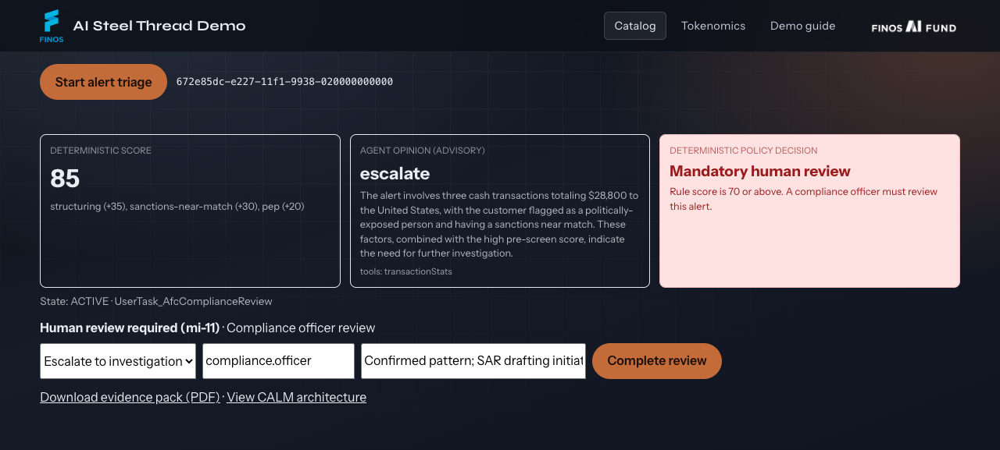
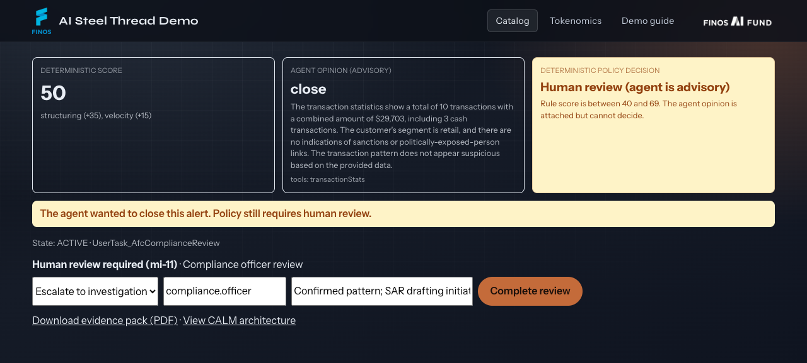
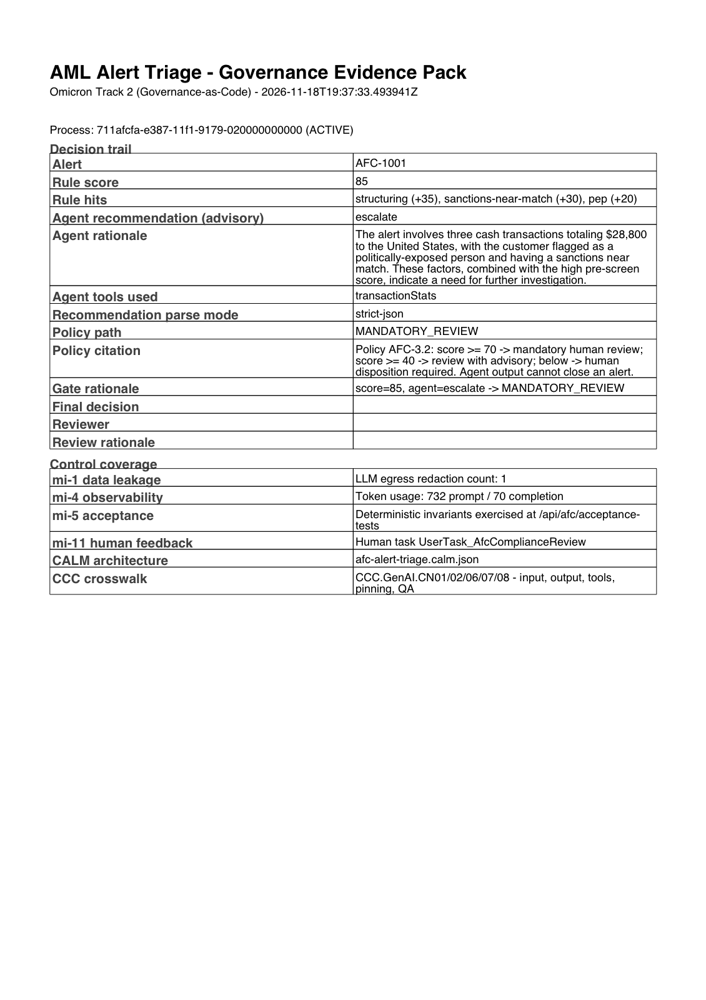

# Omicron — AML Alert Triage Steel Thread

**Track 2 (Governance-as-Code) · FINOS Fall 2026 Hackathon**

**Team:** Saketh Cherukuri ([@ssaketh-ch](https://github.com/ssaketh-ch)) · Sai Sravan Cherukuri ([@saisravan909](https://github.com/saisravan909))

**Walkthrough video (58 s):** [docs/media/omicron-walkthrough.mp4](docs/media/omicron-walkthrough.mp4)

## The pitch

Loan approval proved the FINOS AI Steel Thread works. This submission proves it
generalises: the same Fluxnova + CALM + AIGF pipeline now runs a second
regulated use case, **AML alert triage** (AIGF UC-4), and adds a
**deterministic policy gate** that bounds agent non-determinism. The LLM can
recommend, but it cannot reduce human oversight.

## Why this matters

Transaction-monitoring teams review millions of alerts, most of them false
positives, under BSA/FinCEN deadlines and four-eyes requirements. Agents can
speed up triage, but in a regulated bank an agent's opinion cannot decide
routing on its own. Our pipeline separates the two:

1. **Deterministic pre-screen** (pure Java, no LLM): structuring, high-risk
   jurisdiction, velocity, sanctions near-match, PEP, round amounts → score
   0–100 plus rule hits.
2. **Advisory LLM triage:** the model sees a redacted alert, returns a
   recommendation and rationale; malformed output degrades to "escalate".
3. **Deterministic policy gate:** score ≥ 70 → mandatory human review;
   ≥ 40 → review with advisory; below → an investigator still records the
   disposition. Agent output never closes an alert.
4. **Human review (mi-11):** decision, rationale, reviewer recorded.
5. **Evidence pack:** per-instance PDF with rule hits, agent rationale, gate
   decision, policy citation, token usage, and control coverage.

## Demonstrated behaviour

| Alert | Rule score | Agent says | Deterministic path |
|---|---|---|---|
| High: structuring + PEP + sanctions near-match | 85 | escalate | **MANDATORY_REVIEW** |
| Medium: structuring + velocity | 50 | close | **REVIEW_WITH_ADVISORY** (agent cannot close) |
| Low: single small card transaction | 0 | close | **HUMAN_REVIEW_REQUIRED** |

The middle row is the point: a plausible agent recommendation still cannot
skip human review.

*High-risk alert: deterministic score 85, agent opinion "escalate" (after calling the transaction-stats tool), and a red mandatory-review decision.*

*Medium-risk alert: the agent recommends closing, and policy still requires human review. This is the thesis in one screen.*

*Per-instance evidence PDF: decision trail, tools used, policy citation, and control coverage.*

## FINOS projects in one pipeline

| Project | Role | Where |
|---|---|---|
| **Fluxnova** | BPMN orchestration (`AfcInvestigation_AI`) | `src/main/resources/bpmn/AfcInvestigation_AI.bpmn` |
| **CALM** | Architecture-as-code with attached controls | `architecture/afc-alert-triage.calm.json` |
| **AIGF** | mi-1 leakage prevention, mi-4 observability, mi-5 acceptance, mi-11 human loop | `src/main/java/org/finos/ai/demo/afc/`, `architecture/controls/` |
| **CCC** | GenAI controls CN01, CN02, CN07, CN08 | `docs/ccc-crosswalk.md` |

## What is real vs sample data

- **Real, running code:** Fluxnova process, rule engine, tool-using triage agent
  (read-only tools, every call recorded), policy gate, human task completion,
  evidence PDF, unit tests, and the live acceptance suite at
  `/api/afc/acceptance-tests`.
- **Sample data:** the alert JSON files in `samples/` (synthetic customers and
  transactions). No production or customer data is used.
- **Model:** a local Qwen3-8B via llama.cpp in the demo, or any hosted
  OpenAI-compatible provider by changing `spring.ai.openai.base-url` and the
  model name. No paid keys are required for the local path.

## How to run

See the Quickstart section of [README.md](./README.md). Short version:
install the Fluxnova plugin snapshot, `mvn package`, point the app at an
OpenAI-compatible endpoint, `npm run dev`, open the AML Alert Triage panel.

## Five-minute demo script

1. Problem: alert volume, false positives, SAR deadlines, four-eyes.
2. Architecture: CALM model, four FINOS projects, gate outside the agent.
3. Live: high risk → mandatory review; medium and low → even if the agent
   says close, an investigator still records the disposition.
4. Complete the human task, open the evidence PDF, show control coverage.
5. Close: same steel thread, new regulated use case, agent cannot reduce
   oversight.

## Rubric mapping

| Category | Evidence |
|---|---|
| Ecosystem integration | Four FINOS projects wired in one runtime; crosswalk in `docs/ccc-crosswalk.md`; controls attached in CALM |
| Technical execution | Working end-to-end POC, tool-using triage agent, UI, tests (`AfcRuleEngineTest`, `AfcTriageParsingTest`), acceptance suite endpoint, evidence PDF |
| Business value | Realistic regulated workflow, deterministic controls, audit trail |
| Bonus: innovation & build velocity | Agent-assisted build, local inference (no data egress), acceptance-as-code invariants |

## Verification

- CALM validation: `npx @finos/calm-cli validate -a architecture/afc-alert-triage.calm.json -u architecture/url-to-local-file-mapping.json` reports no errors and no warnings.
- Fresh clone of `main`: app packages, 14 unit tests pass (`AfcRuleEngineTest`, `AfcTriageParsingTest`), and the frontend builds (`npm ci && npm run build`).

## Attribution

Based on the FINOS AI Steel Thread demo
([finos-hack/ai-steel-thread-demo](https://github.com/finos-hack/ai-steel-thread-demo),
Apache-2.0). See `UPSTREAM.md`, `LICENSE`, and `NOTICE`.
